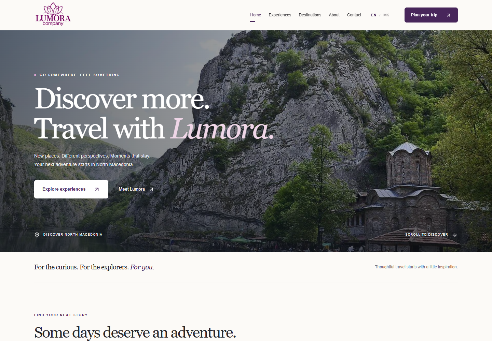
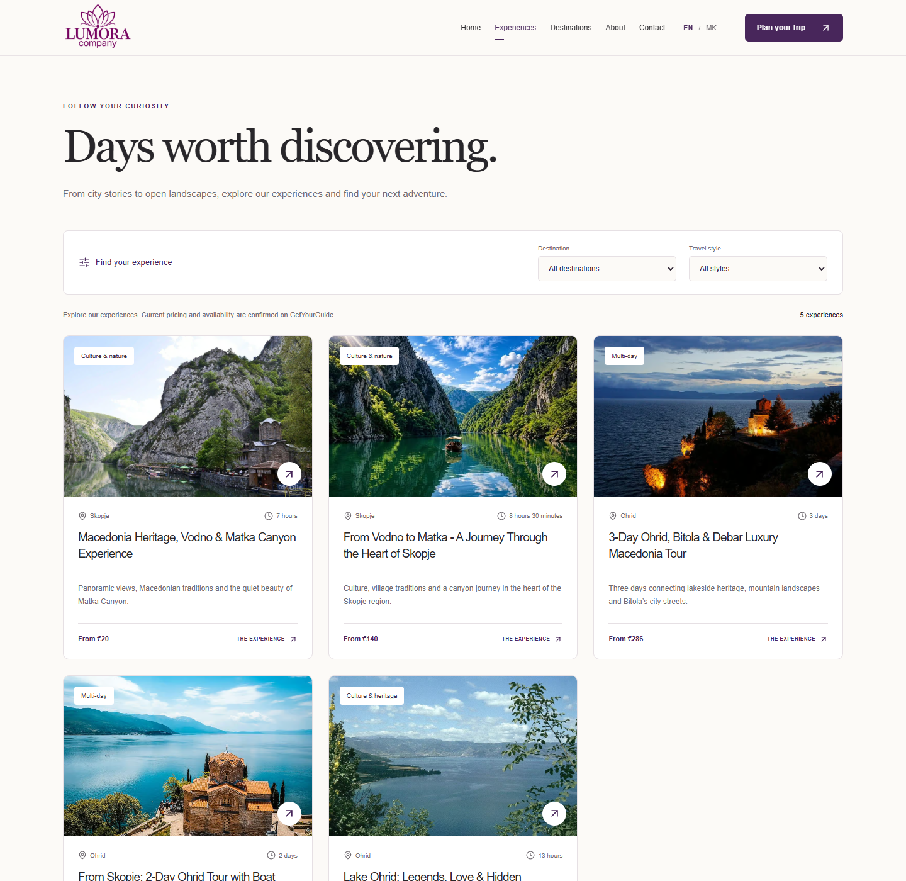
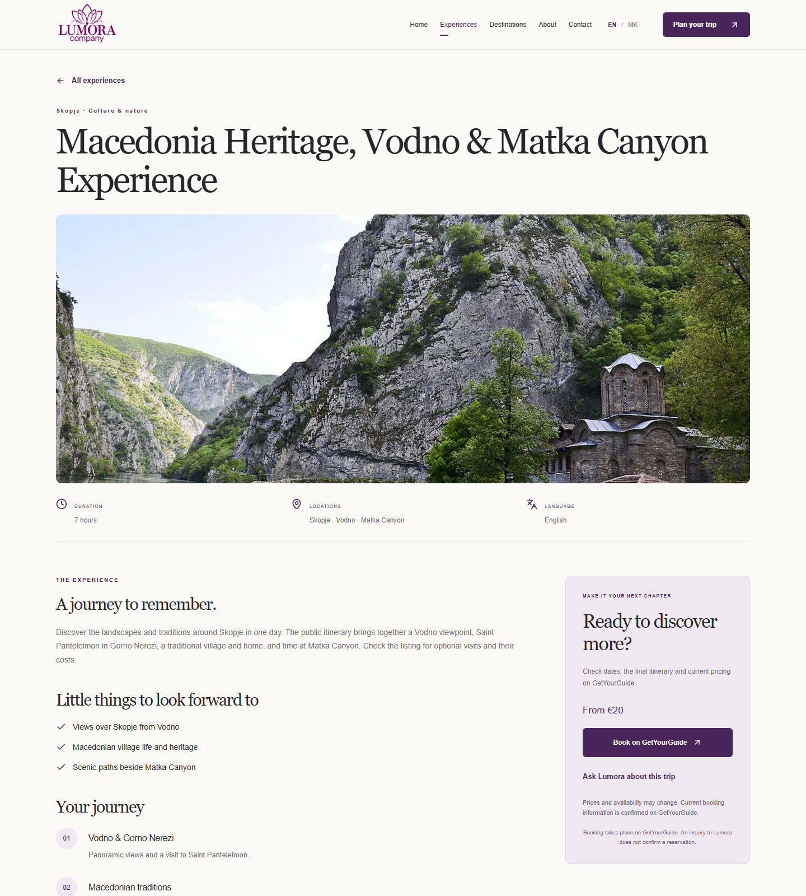
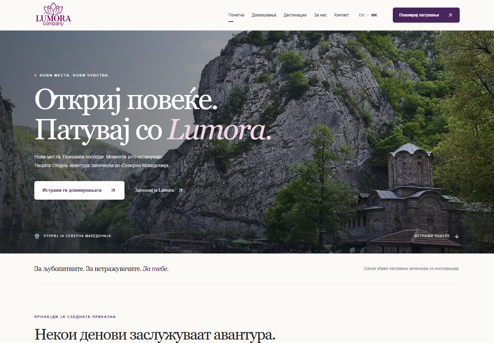
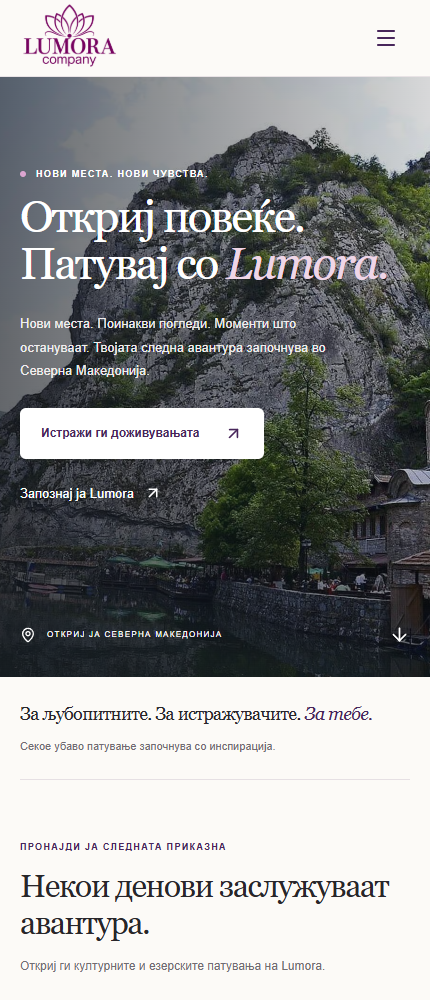

# Lumora Company Website


## Македонски

Комплетна документација за универзитетски проект по Бизнис пракса: двојазична презентациска веб-страница за реалната туристичка компанија Lumora Company во Северна Македонија. Наменета е за професорот, студентскиот тим, колегите и идните одржувачи. Го опишува постојниот код, а не непостоечки планирани функции.

| Ресурс             | Адреса / статус                                                                               |
| ------------------ | --------------------------------------------------------------------------------------------- |
| Јавна веб-страница | [Очекувана адреса на GitHub Pages](https://mtomashevski.github.io/lumora-company-website/)    |
| Репозиториум       | [mtomashevski/lumora-company-website](https://github.com/mtomashevski/lumora-company-website) |
| Instagram          | [@lumoraadventures](https://www.instagram.com/lumoraadventures/)                              |
| GetYourGuide       | [Lumora Company](https://www.getyourguide.com/lumora-company-s800323/)                        |

**Содржина:** [Преглед](#mk-overview) · [Архитектура](#mk-architecture) · [Локализација](#mk-language) · [Форма](#mk-form) · [Стартување/објавување](#mk-deployment) · [Одржување](#mk-maintenance) · [Академски податоци](#mk-academic) · [Презентација](#mk-presentation) · [English](#english)

<a id="mk-overview"></a>

### 1. Преглед, мотивација и цели

Lumora е реален туристички бизнис со Instagram и GetYourGuide присуство. Проектот создава независна брендирана веб-страница каде посетителите ја запознаваат компанијата, истражуваат дестинации, споредуваат активности и читаат информации пред резервација. GetYourGuide останува надворешната платформа за booking: оваа веб-страница не обработува плаќања и не потврдува резервации.

Социјалните објави не се замена за структуриран каталог со навигација, филтри и централизирани компаниски информации. Решението ги поврзува откривањето, двојазичната презентација и контактот со веќе постојната booking инфраструктура. Тоа ја прави Lumora соодветна за Бизнис пракса: се решава вистинска потреба на мал бизнис, без измислена компанија или преувеличување на нејзината историја/успех.

Цели: веродостојна компаниска презентација; пет реални активности со детали; EN/MK; добра употребливост на телефон/таблет/десктоп; вистински Instagram/GetYourGuide канали; јасна подготовка на прашање; одржливи податоци одвоени од UI; едноставно статичко објавување и идно проширување.

Наменети корисници се меѓународни посетители на Северна Македонија, туристи заинтересирани за Скопје, Водно, Матка, Охрид, Битола и Дебар, парови, мали групи и посетители што ја откриваат Lumora преку Instagram. Ова е целна публика според намената, не резултат од демографско истражување.

### 2. Функционалност, рути и кориснички тек

| Рута                  | Реална функционалност                                                                                      |
| --------------------- | ---------------------------------------------------------------------------------------------------------- |
| `/`                   | Hero фотографија, избрани активности, дестинации, претставување на услугата, чекори и CTA                  |
| `/experiences`        | Каталог, филтри по дестинација/категорија, број на резултати и празна состојба со reset                    |
| `/experiences/:slug`  | Динамични детали: фотографии, опис, duration, locations, highlights, галерија и достапни опционални секции |
| `/destinations`       | Седум локации поврзани со реалниот каталог и филтрираните резултати                                        |
| `/about`              | Конзервативна приказна за Lumora и секција со управителите                                                 |
| `/contact`            | Реални канали за контакт, provider link и форма за прашање                                                 |
| `/privacy`            | Основни информации за приватноста и јавни регистрациски/компаниски податоци                                |
| Непостоечка рута/slug | Брендирана NotFound страница со корисни врски и `noindex`                                                  |

Header/footer, EN/MK селекторот и responsive/mobile menu се заеднички. Нема database, auth, admin/CMS, локален checkout, блог со измислени објави или fake cookie banner.

**Booking тек:** посетител → Home/Experiences → филтер или избрана тура → детали → „Book on GetYourGuide“ → вистинската надворешна активност за достапност, услови и плаќање.

**Прашање:** детали → `/contact?experience=<slug>` → предизбрана тура → пополнување/валидација → локално подготвена порака → copy и рачно испраќање преку Instagram. Без конфигуриран endpoint нема серверско испраќање. Јазикот се менува без губење на рутата, филтрите или веќе внесените полиња.

### 3. Реални компаниски информации и активности

[src/data/company.ts](src/data/company.ts) ги централизира Lumora Company, Instagram/GetYourGuide, регистрираната адреса `26 Boris Trajkovski 3, 1000 Skopje, Greater Skopje, North Macedonia`, регистрацискиот број `4058026555925`, управителите **Stefanija Dimeska** и **Iva Arsova**, и PNG логото. Тоа се јавни деловни податоци доставени за проектот и проверени во развојот; адресата не е ветување за прием на посетители без договор.

Управителите се наведени со потврдената улога; не се измислени биографии, фотографии или посебен статус „основач“. Не се студентските автори. Email, телефон и WhatsApp не се доставени и празните вредности ги кријат тие канали.

[src/data/experiences.ts](src/data/experiences.ts) го содржи реалниот каталог:

| Јавен наслов                                                | Slug                             | Траење             | Почетна цена во кодот |
| ----------------------------------------------------------- | -------------------------------- | ------------------ | --------------------- |
| Macedonia Heritage, Vodno & Matka Canyon Experience         | `macedonia-heritage-vodno-matka` | 7 часа             | од €20                |
| From Vodno to Matka - A Journey Through the Heart of Skopje | `vodno-to-matka-journey`         | 8 часа и 30 минути | од €140               |
| 3-Day Ohrid, Bitola & Debar Luxury Macedonia Tour           | `three-day-ohrid-bitola-debar`   | 3 дена             | од €286               |
| From Skopje: 2-Day Ohrid Tour with Boat Ride & Hotel Stay   | `two-day-ohrid-boat-hotel`       | 2 дена             | од €184               |
| Lake Ohrid: Legends, Love & Hidden Treasures from Skopje    | `lake-ohrid-legends-from-skopje` | 13 часа            | од €56                |

`sourceChecked` е `2026-09-30`. Цените ја документираат source содржината, не гарантираат денешна цена/достапност; тие се потврдуваат на GetYourGuide. Нејасни или недостапни детали за дополнителни активности/влезници, големина на група или распоред не се претставуваат како гарантирани. „Luxury“ е дел од јавниот наслов на конкретната тура.

### 4. Визуелна документација

Свежите снимки се направени од вистинската финална апликација на 30 септември 2026, со официјалното PNG лого. Се чуваат во `docs/screenshots/`, одделно од продукциските слики; не се макети.



Home ја претставува компанијата и примарниот туристички CTA.



Картичките и деталите користат ист source запис.



Една вистинска динамична страница со релевантни информации.



Истиот UI со македонска содржина.



Мобилен приказ со компактно мени, читлив наслов и touch-friendly CTA.

### 5. Технологии и архитектонски одлуки

| Технологија                   | Улога и причина за избор                                                                    |
| ----------------------------- | ------------------------------------------------------------------------------------------- |
| React 19                      | Повторливи UI компоненти и страници, без дуплирање layout/картички во посебни HTML страници |
| TypeScript 6                  | Типови за tour, localization и form податоци; појасна структура и проверки пред build       |
| Vite 8                        | Развоен сервер и production bundling погодни за едноставен статички frontend                |
| React Router 7                | BrowserRouter, slug детали, query филтри и NotFound приказ                                  |
| Tailwind CSS 4 + сопствен CSS | Реално присутни plugin/import; дизајнот главно е со custom класи во `src/index.css`         |
| Lucide React                  | Конзистентни SVG икони                                                                      |
| React Context                 | Централен мал јазичен слој, без посебна i18n библиотека или Redux                           |
| ESLint/typescript-eslint      | Статичка проверка на код според локалните правила                                           |
| Prettier                      | Форматирање                                                                                 |
| Playwright                    | Автоматизирани browser тестови, default инсталиран Microsoft Edge                           |
| pnpm                          | Пакети и верзии фиксирани во `pnpm-lock.yaml`                                               |

Точните dependency опсези се во [package.json](package.json), разрешените верзии во lockfile. Малиот јавен каталог е во source; не бара database или auth. GetYourGuide веќе ги обработува трансакциите. Статички frontend го исполнува тековниот presentation/discovery опсег без непотребен backend. Реална inquiry испорака би барала дополнителен сервис.

React го поедноставува повторувањето; TypeScript го документира заедничкиот модел; Vite го намалува setup товарот. Клиентското рутирање овозможува навигација без целосно повторно вчитување, со услов хостот да обработува директни URL/refresh барања. Тоа не е SSR.

`tsconfig.json` поврзува app (`src`/DOM) и node (`vite.config.ts`) конфигурации. Користат ES2023, `noEmit` и проверки за неискористени вредности. `strict: true` не е експлицитно вклучено. `tsc -b` проверува типови; Vite создава JavaScript.

<a id="mk-architecture"></a>

### 6. Структура, компоненти и data model

```text
src/
  main.tsx / App.tsx       Почеток, providers и routing
  components/
    layout/               Layout/Brand, header/footer, LanguageSelector
    experiences/          ExperienceCard
    contact/              InquiryForm
    about/                Directors
    common/               Image, ExternalLink, SectionHeading, InquiryCTA,
                          CompanyInformation, ErrorBoundary
  pages/                  Home, Experiences, ExperienceDetail, Destinations,
                          About, Contact, Privacy, NotFound
  data/                   company.ts, experiences.ts
  types/                  experience.ts
  i18n/                   en.ts, mk.ts, types.ts, LanguageContext.tsx
  hooks/                  usePageMeta.ts
  utils/                  inquiry.ts, deployment.ts
  index.css               Стилови и responsive правила
public/
  images/
    brand/                lumora-logo.png
    experiences/          Пет папки со доставени AVIF/WebP фотографии
    hero/, destinations/, about/  Постари неактивни stock ресурси
    fallback.svg / CREDITS.md
  robots.txt / _redirects
scripts/generate-seo.mjs   Build метаподатоци и 404.html
scripts/serve-pages.mjs    Статички Pages QA сервер
.github/workflows/        deploy-pages.yml
tests/site.spec.ts         Browser тестови
docs/screenshots/          README снимки
vite.config.ts / tsconfig*.json / eslint.config.js
playwright.config.ts / vercel.json / .env.example
package.json / pnpm-lock.yaml / README.md
```

```text
Посетител → React UI + LanguageProvider → BrowserRouter + Layout
  → Страници / повторливи компоненти
      ← experience data + company config + EN/MK речници
      → GetYourGuide / Instagram (надворешни links)
      → InquiryForm → локална порака или конфигуриран HTTP endpoint
```

`Layout` споделува header/footer и навигација. `ExperienceCard` е ист на Home и во каталог. `Image` споделува loading/fallback/base-path, `ExternalLink` безбедносни атрибути, `SectionHeading` и `InquiryCTA` повторливи секции. Копчињата користат CSS класи; нема посебна Button компонента. Дестинациските картички и галериите се рендерираат во страниците, не во непостоечки посебни компоненти.

[Experience](src/types/experience.ts) ги дефинира:

| Група             | Реални полиња                                                                                     |
| ----------------- | ------------------------------------------------------------------------------------------------- |
| Идентитет         | `id`, `slug`, `featured`, `sourceChecked`                                                         |
| Филтри/локации    | `destination`, `locations`, `category`, `categories`                                              |
| Двојазичен текст  | `title`, `shortDescription`, `description`, `duration`, `highlights`                              |
| Цена              | опционален `priceFrom`, `currency: 'EUR'`, опционален `priceLabel`                                |
| Слики             | `heroImage`, `gallery`; `TravelImage` содржи `src`, двојазичен `alt`, опционален `position`       |
| Опционални детали | `itinerary`, `included`, `notIncluded`, `meetingPoint`, `languages`, `groupSize`, `activityLevel` |
| Booking           | опционален `getYourGuideUrl`; fallback кон компаниски профил                                      |

`LocalizedText` е `{ en: string; mk: string }`. Еден `Experience` запис напојува card, detail, form избор и SEO build. `:slug` ја наоѓа активноста; нов запис не бара нова detail компонента. Опционалните секции се прикажуваат само ако постојат.

Locations map ги дефинира имињата и сликите; `destinations` ги задржува само локациите застапени во tour `locations` и ги брои активностите. Категориите се изведуваат од записите. Филтрите користат стабилни ID вредности во query параметри `destination`/`category`, со проверка на `locations`/`categories` и AND комбинација. Тоа дозволува share/refresh и промена на јазик без губење на филтер.

Business config е во `company.ts`, одвоен од `website.siteUrl`/`inquiryEndpoint`. Менувајте ги јавните канали, регистрација и `directors` таму, па проверете ги сродните EN/MK реченици. Централизацијата го намалува повторувањето; не значи дека секое спомнување на брендот во copy се генерира автоматски.

<a id="mk-language"></a>

### 7. EN/MK локализација и localStorage

[en.ts](src/i18n/en.ts) го дефинира сетот UI клучеви; [mk.ts](src/i18n/mk.ts) ги користи истите `TranslationKey` типови. `LanguageProvider` дава `language`, `setLanguage`, `t(key, params)` за речнички текст/параметри и `l(localizedText)` за business текст. Навигацијата, формата, validation и metadata користат `t`; тури, локации и alt користат `l`. Не се дуплира целиот сајт.

Стандардниот јазик е EN. При иницијализација се чита `localStorage['lumora-language']`; само `mk` го избира македонскиот. По промена се запишува `en`/`mk` и се ажурира `document.documentElement.lang`. EN/MK копчињата имаат `aria-pressed` и јазични имиња. Блокиран storage е обработен со `try/catch`: смената работи, но не се зачувува.

Преференцијата опстојува по refresh/нова посета без login/database. Само јазикот се чува во storage, не inquiry полињата. Нема `/mk`/`/en` рути: двата јазика ја делат URL, што го ограничува посебното language SEO. Додавање трет јазик бара типови, речник, provider/selector, metadata/storage и сите business преводи.

### 8. GetYourGuide и Instagram интеграции

Ова се **надворешни врски**, не API/OAuth, Instagram feed или live availability синхронизација. Секој tour запис има соодветна GetYourGuide activity URL. Деталите водат таму за тековни услови/достапност/payment; компанискиот профил е достапен од контакт/footer. Кликањето не создава резервација на Lumora сајтот.

Instagram `@lumoraadventures` е во footer, Contact, Privacy и prepared inquiry чекорот. Не се испраќаат пораки автоматски. `ExternalLink` користи `target="_blank"`, `rel="noopener noreferrer"` и screen-reader најава за нов таб.

Овој пристап избегнува дуплирање на booking инфраструктура и ја задржува presentation улогата. Documentation links се совпаѓаат со config, без tracking параметри. Тестовите проверуваат точни href/rel вредности, не достапност на туѓ сервис. При документациската проверка автоматското преземање на двата профила не успеа; отворете ги рачно пред презентација.

<a id="mk-form"></a>

### 9. Контакт форма: точна имплементација

[InquiryForm.tsx](src/components/contact/InquiryForm.tsx) го прикажува UI; [inquiry.ts](src/utils/inquiry.ts) ги дефинира читањето, валидацијата и transport adapter.

| Поле       | Правило                                                                        |
| ---------- | ------------------------------------------------------------------------------ |
| Име        | задолжително, 2–100 знаци по trim                                              |
| Email      | задолжително, regex формат, до 254 знаци                                       |
| Телефон    | опционален, до 40 знаци; нема потврда на бројот                                |
| Активност  | опционална; избор од каталог или општ интерес; познат query slug ја предизбира |
| Патници    | задолжителен цел број 1–100, default 2; не гаранција за tour капацитет         |
| Датум      | опционален, `YYYY-MM-DD`, не минат според `Europe/Skopje`                      |
| Порака     | задолжителна, 10–3000 знаци                                                    |
| Приватност | задолжителна согласност                                                        |

Сопствената `noValidate` валидација дава преведени errors, `aria-invalid`/`aria-describedby` и фокус на првото погрешно поле. Грешката на поле се чисти при внесување. Loading состојбата го оневозможува submit. Prepared/sent насловот добива фокус.

**Тековно, без endpoint:** `submitInquiry` враќа `prepared` без мрежно барање. Пораката е локално составена, јасно означена „не е испратена“, може да се копира и рачно да се испрати преку Instagram. Clipboard неуспех има feedback и рачно copy е можно. Формата е во browser меморија; refresh ги губи податоците. Instagram отворањето не ги пренесува автоматски.

**Идна конфигурирана патека:** `VITE_INQUIRY_ENDPOINT` активира JSON POST со `name`, `email`, `phone`, `experience`, `travelers`, `date`, `message`, `consent` и timeout 15 секунди. HTTP успешен одговор активира `sent`; неуспех error. Тоа означува прифатено HTTP барање, не потврден email или reservation. Backend/email сервис не постои во репозиториумот и real delivery не е тестирана.

За продукциска испорака треба серверска validation, CORS, abuse prevention, реална email услуга и retention/deletion правила. Тајните се серверски: `VITE_` поставките се јавни. Ажурирајте ја privacy информацијата според реалниот provider пред активирање.

### 10. Слики, UX, responsive и accessibility

Локалните AVIF/WebP ресурси се во `public/images/experiences/`: `macedonian-heritage`, `vodno-matka`, `ohrid-bitola-debar`, `skopje-ohrid-2-day`, `lake-ohrid`. `experiences.ts` ги мапира hero/gallery/destination/Home/About фотографиите. Старите stock ресурси се задржани, но не се активни.

AVIF/WebP се ефикасни формати за web фотографија. Доставените датотеки се користат директно; нема масовна conversion или автоматски image pipeline. `Image` користи eager/high-priority за hero/logo, lazy loading за некритични слики, async decoding и base-aware локален fallback. Legacy `-1200`/`-1920` WebP имиња поддржуваат `srcSet`/`sizes`; тоа не се создава автоматски за сите AVIF. CSS proportions/контејнери го намалуваат layout shift; hero/cards користат crop, gallery `contain` за да остане видлив предметот.

Официјалното `public/images/brand/lumora-logo.png` е 1536 × 1024 (3:2), сервирано непроменето со alpha transparency во desktop/mobile header, footer и favicon. CSS auto height/contain спречуваат деформација. Алтернативниот текст е двојазичен. [CREDITS.md](public/images/CREDITS.md) го објаснува потеклото; бизнисот треба да ги потврди правата за објавување.

Дизајнот користи виолетова `#48265b`, крем `#fcfaf7`, темен текст, Georgia/Times serif наслови и Arial/Helvetica body, без преземање web fonts. Фотографија, whitespace, повторливи cards и booking CTA хиерархија создаваат веродостојно туристичко искуство. Не се тврди формално UX истражување.

CSS grid/flex и media queries (особено 1100, 800, 540px, со дополнителни правила) ги приспособуваат колоните, формата и навигацијата. Mobile menu е за мали екрани. Патниците често користат телефон додека патуваат; проверени се 375/430/768/1024/1440px, долги македонски текстови и overflow.

Accessibility мерките вклучуваат semantic HTML, еден h1, skip link, labels/alt, видлив keyboard фокус, вистински buttons/links, `html.lang`, menu aria атрибути, Escape затворање, focus management и `prefers-reduced-motion`. Основните keyboard текови се тестирани. Нема WCAG сертификат или целосен независен accessibility audit.

### 11. SEO, приватност и edge cases

[usePageMeta.ts](src/hooks/usePageMeta.ts) ажурира title/description, Open Graph, language и robots по навигација/јазик. Со домен додава canonical/OG URL/image. Clean slug, headings и alt ја прават содржината читлива за пребарувачи и посетители.

[generate-seo.mjs](scripts/generate-seo.mjs) генерира англиски HTML метаподатоци за шест main рути + пет тури (11 тековно). Body е client-rendered; нема целосен SSR. Со production origin (GitHub Pages default или `VITE_SITE_URL` override) создава sitemap, canonical/OG URL и TravelAgency JSON-LD со вистински name/address/identifier/social links, без измислени reviews. Robots и favicon постојат и без домен. Нема посебни language URLs/hreflang.

Privacy опишува local inquiry, language-only localStorage, локални фотографии и надворешни сервиси. Нема analytics/tracking cookies, па нема fake consent banner. Хостот може да води access logs; надворешните сервиси имаат свои правила. Основните правни текстови не се професионален правен совет.

Обработени се invalid route/slug, празни filters, image fallback, missing optional channels, blocked storage, invalid form, future request error/timeout и React rendering errors преку `ErrorBoundary`. Тој не ги фаќа сите async/browser грешки. Recovery врската на ErrorBoundary ја користи апликациската база, па враќа во Lumora и при hosting во поддиректориум.

<a id="mk-deployment"></a>

### 12. Стартување, production build и deployment

Node минимумот во `engines` е 22.12; проверената средина користи Node 24. `packageManager` е pnpm 11.25.0. Обезбедете достапен pnpm со соодветна верзија. Официјален репозиториум: https://github.com/mtomashevski/lumora-company-website.git. Преземете го проектот или клонирајте ја оваа адреса.

Во коренот:

```sh
pnpm install --frozen-lockfile
pnpm dev
```

Default dev URL е `http://localhost:5173`; Vite го покажува вистинскиот порт ако е зафатен. Копирајте `.env.example` во `.env.local` ако треба да менувате поставки. За root local приказ defaults се доволни.

| Команда              | Ефект                                                         |
| -------------------- | ------------------------------------------------------------- |
| `pnpm dev`           | Vite dev server                                               |
| `pnpm typecheck`     | `tsc -b --pretty false`                                       |
| `pnpm lint`          | `eslint .`                                                    |
| `pnpm build`         | `tsc -b`, Vite build, Node SEO script со TypeScript stripping |
| `pnpm preview:pages` | Строг статички Pages QA сервер на 4180, без SPA rewrite       |
| `pnpm preview`       | Локално сервирање на `dist/`, default 4173                    |
| `pnpm test`          | Playwright, со претходно стартуван сервер                     |
| `pnpm format`        | Prettier за src/Vite/index; README не е во оваа команда       |

```sh
pnpm typecheck
pnpm lint
pnpm build
pnpm preview --host 127.0.0.1 --port 4173
```

`dist/` содржи JS/CSS, public ресурси и route HTML. Preview не е јавен production hosting. Промените во build env бараат rebuild.

| Поставка                | Значење                                                                                                     |
| ----------------------- | ----------------------------------------------------------------------------------------------------------- |
| `VITE_SITE_URL`         | HTTP(S) origin без pathname/credentials/trailing slash; production default `https://mtomashevski.github.io` |
| `VITE_BASE_PATH`        | Точна public pathname; production default `/lumora-company-website/`, dev default `/`                       |
| `VITE_INQUIRY_ENDPOINT` | Опционален јавен POST endpoint, тековно празен; не тајна                                                    |

**FCSE/ФИНКИ:** побарајте точен public origin, целосна account/project pathname, directory-index правила и SPA fallback можност. Нема претпоставен URL или готов FCSE workflow. Vite base и [deployment.ts](src/utils/deployment.ts) ги усогласуваат assets, BrowserRouter basename, сите локални фотографии/fallback, favicon и SEO URLs. `./` base не е поддржан; потребна е апсолутна pathname.

Поставете `.env.local`, направете build, прикачете ја **содржината** на `dist/` во mount директориумот; не додавајте уште една копија од base во dist. Серверот треба прво да сервира постојни files/route index, па unknown app URLs да ги rewrite кон `<base-path>index.html`. BrowserRouter не може сам да поправи server refresh. Локалната nested-base QA не е доказ за FCSE правила.

Ако хостот нема indexes/fallback, треба намерна routing промена, на пример HashRouter; тој сега не е имплементиран. На вистинскиот хост тестирајте detail direct URL, refresh, photos и unknown route. SPA 404 може да има HTTP 200; вистински HTTP 404 бара server rules.

Netlify root fallback е во `public/_redirects`; Vercel root rewrite е во `vercel.json`. Тоа не се FCSE правила и можеби бара адаптација. Сопствен хост може да примени соодветна Nginx `try_files` логика. GitHub Pages deployment е во `.github/workflows/deploy-pages.yml`: генерирани route indexes и custom `404.html` овозможуваат BrowserRouter без серверски SPA rewrite. За subdirectory, `dist/robots.txt` е template: неговиот sitemap reference треба во вистинскиот origin-root robots со помош на администратор.

<a id="mk-maintenance"></a>

#### GitHub Pages: конкретна конфигурација

Очекувана адреса: https://mtomashevski.github.io/lumora-company-website/. Таа е потврдена deployment цел, не тврдење дека објавувањето веќе е завршено.

Production defaults се `VITE_BASE_PATH=/lumora-company-website/` и origin `https://mtomashevski.github.io`; развој без env override останува на `/`. Ако копирате .env.example, и dev користи зададена база. Вредностите може да се override за FCSE/друг хост; не користете Pages база таму без проверка.

Workflow `.github/workflows/deploy-pages.yml` се активира на push во main и рачно преку workflow_dispatch. Користи Node 24 и pnpm од packageManager, frozen lockfile install, typecheck/lint/build, Pages artifact од dist и deploy job со pages:write/id-token:write во github-pages environment. Build output и node_modules не се commit-ираат; не е потребна gh-pages гранка или личен token. Автоматскиот GITHUB_TOKEN го користат официјалните Pages actions.

Во GitHub → Settings → Pages → Build and deployment → **Source: GitHub Actions**. Не избирајте Deploy from a branch. Ако првиот workflow не успее пред да ја поставите оваа опција, пуштете го повторно од Actions → Deploy Lumora to GitHub Pages → Run workflow (main).

Рутирање: build создава 11 познати route index.html датотеки. GitHub Pages ги сервира директно, со нормален trailing-slash redirect за директориум. Custom 404.html ја вчитува истата React апликација со absolute base-aware assets и noindex; непознат URL го задржува својот pathname и HTTP 404. Нема hash URL или redirect encoding script. Генерирана .nojekyll датотека е вклучена само во build artifact. На друг хост може да се користи fallback или истата custom 404 политика.

За локална production проверка: pnpm build, потоа pnpm preview и отворете /lumora-company-website/. За строг Pages модел, користете pnpm preview:pages (порт 4180); тој нема SPA rewrite. Целосниот Pages suite го стартува серверот автоматски:

```powershell
$env:TEST_PAGES_MODE = '1'
$env:TEST_BASE_PATH = '/lumora-company-website/'
$env:TEST_BASE_URL = 'http://127.0.0.1:4180'
pnpm test
```

За root dev тестирање не поставувајте TEST_PAGES_MODE и користете TEST_BASE_PATH=/; за preview користете ја production база. Pages-only тестот е прескокнат надвор од Pages режим. Browser links, query предизборот, EN/MK и localStorage се зачувани.

### 13. Одржување и тестирање

| Промена                       | Место / проверка                                                                      |
| ----------------------------- | ------------------------------------------------------------------------------------- |
| Company/social/email/phone    | `company.ts`, само verified public values; footer/Contact/Privacy и двете copy верзии |
| Управители                    | `company.directors`; опционални одобрени `photo`, EN/MK `biography`, `profileUrl`     |
| Tour copy/duration/highlights | соодветниот запис во `experiences.ts`, двата јазика                                   |
| Price/booking                 | `priceFrom`, `currency`, `getYourGuideUrl`; потврдете ја надворешната понуда          |
| Нова дестинација              | `LocationId`, locations map и tour `locations`; counts се изведуваат                  |
| Нова категорија               | `Category`, tour categories и `category.*` во двата речника                           |
| UI превод                     | EN key + MK key; typecheck за усогласеност                                            |
| Слики                         | релевантна asset папка, `src`, EN/MK `alt`, optional crop `position`                  |
| Styles/screenshots            | `index.css`; mobile/MK wrapping QA; повторно снимете `docs/screenshots`               |

**Нова тура:** (1) проверете услуга/booking URL/asset права; (2) додадете фотографии во experience папка; (3) внесете цел `Experience` со уникатни id/slug, EN/MK, locations/categories, duration, hero/gallery, featured и sourceChecked; (4) додајте само познати optional детали и информативна price; (5) ажурирајте типови/map/преводи за нови locations/categories; (6) проверете cards, filters, details, inquiry и дестинации на EN/MK; (7) ажурирајте документација/test очекувања; (8) typecheck/lint/build/browser QA. SEO route листата автоматски го вклучува записот.

[tests/site.spec.ts](tests/site.spec.ts) има 25 browser тестови: routes и пет details на EN/MK/пет ширини; overflow/console; filters; persistence; mobile keyboard; local inquiry/copy без POST; real booking href/rel; legal data; images/logo/favicon 3:2; invalid route/fallback/blocked storage. Test runner не стартува сервер автоматски.

За dev: терминал 1 `pnpm dev`, терминал 2 `pnpm test`. За production: прво build/preview, потоа:

```powershell
# PowerShell
$env:TEST_BASE_URL = 'http://127.0.0.1:4173'
$env:TEST_BASE_PATH = '/lumora-company-website/'
pnpm test
```

```sh
# POSIX shell
TEST_BASE_URL=http://127.0.0.1:4173 TEST_BASE_PATH=/lumora-company-website/ pnpm test
```

Default `msedge` бара инсталиран Edge. Алтернатива: `pnpm exec playwright install chromium`, па env `PLAYWRIGHT_CHANNEL=chromium`. Download бара мрежа. Тестовите поддржуваат `TEST_BASE_PATH`. Pages режимот автоматски стартува committed static QA server, со directory indexes и вистински HTTP 404, без SPA rewrite; ги проверува директните URL и refresh.

Автоматизиран browser audit помина 25/25. Визуелната проверка беше одделна: доставени фотографии, desktop/mobile снимки, crops, официјално лого, MK wrapping. Документациската задача повторно проверува typecheck/lint/build и снима нови screenshot примери. Пред предавање, рачно проверете надворешни профили, keyboard flow, фактички услови и вистински FCSE refresh. Не се тврди независна безбедносна проверка, тестирање под оптоварување или правна ревизија.

### 14. AI-поддршка, ограничувања и иднина

AI алатки, вклучувајќи Codex, помогнаа со имплементација, code generation, debugging, refactoring, повторливи задачи, проверки и документација. Тимот го избра реалниот бизнис, ги зададе барањата/опсегот, достави деловни податоци/слики, го насочи UX, прегледуваше резултати и побара корекции, вклучувајќи финално лого и EN/MK.

Автоматизираните проверки се извршени со алатки; студентите треба да ја разберат финалната структура, да ја потврдат factual/academic содржината и да направат финален review. Не тврдејте дека секој студент лично го напишал/тестирал секој дел ако тоа не е точно. AI не ја заменува одговорноста за точност.

Нема backend delivery, database, auth, CMS, direct payment, live availability или social API. Содржината во кодот бара повторен build; body е client-rendered, јазиците делат URL, FCSE host не е потврден, а реалното јавно објавување се потврдува преку GitHub Actions. Ова се граници на презентацискиот опсег, не измислени неуспеси.

Идни, **неимплементирани** подобрувања: inquiry backend/transactional email; повеќе реални активности/јазици; CMS ако каталогот порасне; language SEO/prerender; CI/deployment pipeline; analytics само со review на consent/privacy. Автоматски тестови веќе постојат и може да се прошируваат. Direct booking има смисла само ако бизнисот го побара.

<a id="mk-academic"></a>

### 15. Академски информации и автори

| Поле                   | Податок                                                     |
| ---------------------- | ----------------------------------------------------------- |
| Проект                 | Lumora Company Website                                      |
| Контекст               | Универзитетски проект по Бизнис пракса за реален мал бизнис |
| Факултет / универзитет | **[Да се дополни официјален назив]**                        |
| Предмет                | Бизнис пракса — **[Да се потврди официјален назив/код]**    |
| Академска година       | **[Да се дополни]**                                         |
| Професор / ментор      | **[Да се дополни]**                                         |
| Тим / група            | **[Да се дополни]**                                         |
| Датум на предавање     | **[Да се дополни]**                                         |

**Студентски автори / проектен тим:**

| Име и презиме                        | Индекс       | Реална улога / придонес |
| ------------------------------------ | ------------ | ----------------------- |
| **[Студент 1]**                      | **[Индекс]** | **[Да се дополни]**     |
| **[Додајте ги вистинските членови]** | **[Индекс]** | **[Да се дополни]**     |

Пополнете во двата јазика пред предавање. Lumora управителите не се автоматски student developers. Нема измислени имиња/индекси/професор/URLs. Потврдете photo права, academic AI правила, live business услови и deployment.

<a id="mk-presentation"></a>

### 16. Насоки за презентација

#### Подготовка и редослед за 5–10 минути

Стартувајте production preview; подгответе Home, каталог, една тура, Contact и `company.ts`, `experiences.ts`, `App.tsx`, `LanguageContext.tsx`. Проверете мрежа за booking/social. Screenshot е резервна документација ако live demo не е возможно; кажете дека е снимка.

| Време      | Тема / точки                                                                |
| ---------- | --------------------------------------------------------------------------- |
| 0:00–1:00  | Lumora и проблем: независна организирана презентација покрај social/booking |
| 1:00–2:00  | Решение/опсег: каталог, EN/MK, mobile, надворешна резервација               |
| 2:00–5:00  | Live јазик, филтер, тура, GetYourGuide, компанија/прашање                   |
| 5:00–7:00  | React reuse, TypeScript модел, slug route, data/UI/translation separation   |
| 7:00–8:00  | LocalStorage, no unnecessary backend/payment, base/fallback hosting         |
| 8:00–9:00  | AI улога, QA, ограничувања и реални подобрувања                             |
| 9:00–10:00 | Прашања со конкретни source примери                                         |

За пет минути, покажете една тура и форма, а архитектурата со еден запис/рута. Не меморирајте говор; објаснете која потреба ја решава секоја одлука.

#### Live-demo тек

1. Home: вистинско лого, business идентитет, CTA.
2. EN → MK и refresh за persistence.
3. Experiences: Matka/Ohrid + категорија, reset/empty ако има време.
4. Вистинска тура: duration, locations, highlights/gallery и разлики во optional секциите.
5. Booking link во нов таб, без реална reservation/payment.
6. Destinations → filtered catalog; About → управители; Privacy → legal data.
7. Contact: празна форма за errors, па синтетички валидни податоци/consent → prepared not sent → copy. Не испраќајте тест прашање до бизнисот.
8. Mobile viewport/menu, keyboard и MK без overflow.
9. `Experience` запис + `App.tsx`: како се додава тура без нов detail page.

#### Што треба да разбира презентерот

Следете `Experience` → card → slug → detail. Објаснете query filters, `t` наспроти `l`, localStorage, adapter и links наспроти API. Знајте дека Vite build не е hosting, BrowserRouter бара fallback, from-price не е live inventory, и формата не испраќа email. Прочитајте ги малите source фајлови и назначете ги вистинските придонеси на тимот.

#### Можни прашања и одговори

| Прашање                          | Точен краток одговор                                                                                                     |
| -------------------------------- | ------------------------------------------------------------------------------------------------------------------------ |
| Зошто оваа компанија?            | Реален мал бизнис со потреба од независна презентациска страница.                                                        |
| Кој проблем го решавате?         | Структуриран двојазичен каталог со компаниски информации и контакт, покрај социјалните и резервациските платформи.       |
| Зошто React?                     | Повторлива употреба на распоредот, картичките и интерфејсот без дуплирани страници.                                      |
| Зошто TypeScript?                | Јасни модели и проверки на типови за тури, преводи и форма.                                                              |
| Зошто Vite?                      | Едноставен dev server и оптимизиран статички build.                                                                      |
| Зошто нема database?             | Мал јавен каталог во кодот; нема профили или тековна достапност на места.                                                |
| Како се чуваат турите?           | Типизиран `Experience[]` во `src/data/experiences.ts`.                                                                   |
| Како работат динамичните детали? | `:slug` наоѓа запис; непознат slug враќа NotFound UI.                                                                    |
| Како работат филтрите?           | Стабилни ID во query параметри, проверка на `locations`/`categories` со AND.                                             |
| Како работи EN/MK?               | Состојба во Context, `t` за речниците и `l` за деловниот текст.                                                          |
| Зошто localStorage?              | Зачувување само на en/mk без профил/backend.                                                                             |
| Што се случува при refresh?      | Јазикот и query параметрите се задржуваат; внесот во меморијата на формата се губи.                                      |
| Зошто GetYourGuide?              | Постоечки канал за резервации на бизнисот; не го дуплираме плаќањето.                                                    |
| Дали сајтот наплаќа?             | Не, плаќањето и достапноста се проверуваат надворешно.                                                                   |
| Дали има social/booking API?     | Не, обични врски со безбедносни атрибути за нов таб.                                                                     |
| Дали формата праќа email?        | Тековно не: подготвува порака за копирање и рачно испраќање преку Instagram.                                             |
| Како би се активирала испорака?  | POST endpoint, серверска валидација, ажурирана приватност и тестови за испорака.                                         |
| Како се оптимизираат сликите?    | AVIF/WebP, одложено вчитување и зададени пропорции; нема автоматска обработка на слики.                                  |
| Зошто PNG?                       | Официјален транспарентен знак, зачуван 3:2 однос.                                                                        |
| Како е responsive?               | Grid/flex, media queries и мобилно мени; проверени пет ширини.                                                           |
| Што е accessibility тука?        | Ознаки/alt, семантички HTML, фокус/skip link, menu ARIA, јазик и намалено движење; нема сертификат.                      |
| Како се решава subdirectory?     | Base поставка за ресурси/слики/рутер и fallback на хостот за refresh.                                                    |
| Што е invalid URL?               | Брендирана 404 со noindex; HTTP статусот зависи од хостот.                                                               |
| Како се додава тура?             | Нов запис со EN/MK, фотографии и резервациска врска, без нова компонента за детали.                                      |
| Како се додава јазик?            | Типови, речник, provider, селектор, метаподатоци и сите деловни преводи.                                                 |
| Каков SEO постои?                | Метаподатоци за рути, читливи URL, robots/favicon; со домен sitemap/canonical/schema; содржината се рендерира клиентски. |
| Како е проверен проектот?        | Typecheck/lint/build, 25 Playwright тестови, visual/nested-base QA.                                                      |
| Што прво би подобриле?           | Реална испорака на прашања и потврден хостинг, потоа деловна содржина и SEO.                                             |
| Користевте AI? За што?           | Да, Codex за код, дебагирање, рефакторирање, проверки и документација.                                                   |
| Што направија студентите?        | Избор на бизнис, опсег и ресурси, преглед, корекции и одлуки; наведете ги вистинските лични придонеси.                   |

#### Објаснување на AI

„Codex го користевме како развојна алатка. Тимот ги зададе барањата и реалните ресурси, го прегледуваше резултатот и ги насочуваше корекциите. Можеме да ја објасниме финалната структура и ограничувањата.“ Дајте пример: real photo замена или base-path корекција. Не звучете одбранбено, не кажувајте само „AI го направи“ и не измислувајте индивидуален придонес.

#### Брз потсетник

| Точка      | Потсетник                                                           |
| ---------- | ------------------------------------------------------------------- |
| Проект     | Lumora Company Website — Бизнис пракса за реален туристички бизнис  |
| Проблем    | Независно структурирано присуство покрај Instagram/GetYourGuide     |
| Решение    | Двојазична презентациска апликација со каталог и тек за контакт     |
| Stack      | React, TypeScript, Vite, Router, Tailwind + custom CSS, Lucide      |
| Јазици     | EN/MK Context, `lumora-language` localStorage                       |
| Data       | `Experience[]` + company config одвоени од UI                       |
| Booking    | Вистинска GetYourGuide активност, без локално плаќање               |
| Contact    | Валидација → локална порака → копирање/Instagram; endpoint е празен |
| Images     | Локални AVIF/WebP и PNG лого, одложено вчитување и fallback         |
| Routing    | BrowserRouter/slug; base и host fallback за nested refresh          |
| Responsive | Grid/flex, мобилно мени, пет ширини                                 |
| AI         | Codex поддршка; тимски опсег, ресурси, преглед и корекции           |
| Иднина     | Inquiry backend, повеќе тури/јазици, SEO/CI                         |

---

## English

Complete documentation for a university Business Practice project: a bilingual presentation website for the real North Macedonian travel business Lumora Company. It is intended for the professor, student team, classmates and future maintainers. It describes the implemented application, rather than features that only exist as plans.

| Resource     | Address / status                                                                              |
| ------------ | --------------------------------------------------------------------------------------------- |
| Live website | [Expected GitHub Pages URL](https://mtomashevski.github.io/lumora-company-website/)           |
| Repository   | [mtomashevski/lumora-company-website](https://github.com/mtomashevski/lumora-company-website) |
| Instagram    | [@lumoraadventures](https://www.instagram.com/lumoraadventures/)                              |
| GetYourGuide | [Lumora Company](https://www.getyourguide.com/lumora-company-s800323/)                        |

**Contents:** [Overview](#en-overview) · [Architecture](#en-architecture) · [Localization](#en-language) · [Inquiry form](#en-form) · [Setup/deployment](#en-deployment) · [Maintenance](#en-maintenance) · [Academic information](#en-academic) · [Presentation](#en-presentation) · [Македонски](#македонски)

<a id="en-overview"></a>

### 1. Overview, motivation and objectives

Lumora is a real travel business with an Instagram presence and GetYourGuide listings. The project adds an independent branded website where visitors can learn about the company, explore destinations, compare experiences and read relevant information before booking. GetYourGuide remains the external booking platform: this website does not process payments or confirm reservations.

Social posts are not a substitute for a structured catalog with navigation, filters and centralized company information. The solution connects discovery, bilingual presentation and contact with the existing booking infrastructure. That makes Lumora suitable for Business Practice: the project addresses a real small-business requirement without inventing a company or exaggerating its history or success.

Objectives: credible company presentation; five real activities with details; EN/MK support; usable mobile/tablet/desktop layouts; real Instagram/GetYourGuide channels; a clear inquiry preparation process; maintainable data separated from UI; straightforward static deployment and future expansion.

Intended users include international visitors to North Macedonia, travelers researching Skopje, Vodno, Matka, Ohrid, Bitola and Debar, couples, small groups and people discovering Lumora through Instagram. These are intended audiences inferred from the website's purpose, not findings from demographic research.

### 2. Features, routes and user journeys

| Route                | Implemented functionality                                                                                           |
| -------------------- | ------------------------------------------------------------------------------------------------------------------- |
| `/`                  | Hero photography, featured experiences, destinations, service positioning, steps and calls to action                |
| `/experiences`       | Catalog, destination/category filters, result count and an empty state with reset                                   |
| `/experiences/:slug` | Dynamic details: photography, description, duration, locations, highlights, gallery and available optional sections |
| `/destinations`      | Seven represented locations linked to filtered real experiences                                                     |
| `/about`             | Conservative Lumora story and managing directors section                                                            |
| `/contact`           | Real contact channels, provider link and inquiry form                                                               |
| `/privacy`           | Basic privacy information and public company/registration details                                                   |
| Unknown route/slug   | Branded NotFound page with useful navigation and `noindex`                                                          |

Header/footer, the EN/MK selector and responsive/mobile navigation are shared. There is no database, authentication, admin/CMS, local checkout, invented blog or fake cookie banner.

**Booking journey:** visitor → Home/Experiences → filter or featured experience → details → “Book on GetYourGuide” → the real external activity for availability, conditions and payment.

**Inquiry journey:** details → `/contact?experience=<slug>` → preselected tour → fields/validation → locally prepared message → copy and manually send through Instagram. Without a configured endpoint there is no server submission. Switching language preserves the current route, filters and already entered form fields.

### 3. Real company information and experiences

[src/data/company.ts](src/data/company.ts) centralizes Lumora Company, Instagram/GetYourGuide, registered address `26 Boris Trajkovski 3, 1000 Skopje, Greater Skopje, North Macedonia`, registration number `4058026555925`, managing directors **Stefanija Dimeska** and **Iva Arsova**, and the PNG logo. These are public business details supplied for the project and checked during development; the address is not a promise of walk-in visitor reception.

The directors are presented in their verified roles. No biographies, portraits or separate “founder” status are invented. They are not the student authors. Public email, telephone and WhatsApp details have not been supplied; empty configuration values hide those channels.

[src/data/experiences.ts](src/data/experiences.ts) contains the real catalog:

| Public title                                                | Slug                             | Duration           | Starting price in source |
| ----------------------------------------------------------- | -------------------------------- | ------------------ | ------------------------ |
| Macedonia Heritage, Vodno & Matka Canyon Experience         | `macedonia-heritage-vodno-matka` | 7 hours            | from €20                 |
| From Vodno to Matka - A Journey Through the Heart of Skopje | `vodno-to-matka-journey`         | 8 hours 30 minutes | from €140                |
| 3-Day Ohrid, Bitola & Debar Luxury Macedonia Tour           | `three-day-ohrid-bitola-debar`   | 3 days             | from €286                |
| From Skopje: 2-Day Ohrid Tour with Boat Ride & Hotel Stay   | `two-day-ohrid-boat-hotel`       | 2 days             | from €184                |
| Lake Ohrid: Legends, Love & Hidden Treasures from Skopje    | `lake-ohrid-legends-from-skopje` | 13 hours           | from €56                 |

`sourceChecked` is `2026-09-30`. These prices document source content and do not guarantee current pricing or availability; GetYourGuide confirms those. Unclear or missing details concerning extra activities/entry fees, group size or itinerary order are not presented as guaranteed. “Luxury” is part of the particular tour's public title.

### 4. Visual documentation

These fresh screenshots were captured from the actual final application on 30 September 2026, with the official PNG logo. They live in `docs/screenshots/`, separately from production images, and are not mockups.


Home introduces the company and the primary travel calls to action.


Cards and details use the same source records.


One real dynamic experience page with relevant information.


The same interface with Macedonian content.


Mobile presentation with a compact menu, readable heading and touch-friendly controls.

### 5. Technologies and architectural decisions

| Technology                  | Role and reason for choosing it                                                                          |
| --------------------------- | -------------------------------------------------------------------------------------------------------- |
| React 19                    | Reusable UI components/pages without duplicating layout and cards across separate HTML files             |
| TypeScript 6                | Types for experience, localization and form data; clearer structures and checks before building          |
| Vite 8                      | Development server and production bundling appropriate for a simple static frontend                      |
| React Router 7              | BrowserRouter, slug details, query filters and NotFound rendering                                        |
| Tailwind CSS 4 + custom CSS | The plugin/import really are present; the visual design primarily uses custom classes in `src/index.css` |
| Lucide React                | Consistent SVG icons                                                                                     |
| React Context               | A small centralized language layer without a separate i18n library or Redux                              |
| ESLint/typescript-eslint    | Static code checks using local rules                                                                     |
| Prettier                    | Formatting                                                                                               |
| Playwright                  | Automated browser tests, using installed Microsoft Edge by default                                       |
| pnpm                        | Package management with resolved versions pinned in `pnpm-lock.yaml`                                     |

Exact dependency ranges are in [package.json](package.json), with resolved versions in the lockfile. The small public catalog lives in source and requires no database or authentication. GetYourGuide already handles transactions. A static frontend meets the current presentation/discovery scope without an unnecessary backend. Real inquiry delivery would need an additional service.

React simplifies reuse, TypeScript documents the shared model, and Vite reduces setup overhead. Client-side routing enables navigation without full page reloads, provided the host handles direct URL/refresh requests correctly. This is not server-side rendering.

`tsconfig.json` references app (`src`/DOM) and Node (`vite.config.ts`) configurations. They use ES2023, `noEmit` and unused-value checks. `strict: true` is not explicitly enabled. `tsc -b` checks types; Vite produces JavaScript.

<a id="en-architecture"></a>

### 6. Structure, components and data model

```text
src/
  main.tsx / App.tsx       Entry point, providers and routing
  components/
    layout/               Layout/Brand, header/footer, LanguageSelector
    experiences/          ExperienceCard
    contact/              InquiryForm
    about/                Directors
    common/               Image, ExternalLink, SectionHeading, InquiryCTA,
                          CompanyInformation, ErrorBoundary
  pages/                  Home, Experiences, ExperienceDetail, Destinations,
                          About, Contact, Privacy, NotFound
  data/                   company.ts, experiences.ts
  types/                  experience.ts
  i18n/                   en.ts, mk.ts, types.ts, LanguageContext.tsx
  hooks/                  usePageMeta.ts
  utils/                  inquiry.ts, deployment.ts
  index.css               Styles and responsive rules
public/
  images/
    brand/                lumora-logo.png
    experiences/          Five folders of supplied AVIF/WebP photography
    hero/, destinations/, about/  Older inactive stock assets
    fallback.svg / CREDITS.md
  robots.txt / _redirects
scripts/generate-seo.mjs   Build metadata and 404.html
scripts/serve-pages.mjs    Static Pages QA server
.github/workflows/        deploy-pages.yml
tests/site.spec.ts         Browser tests
docs/screenshots/          README screenshots
vite.config.ts / tsconfig*.json / eslint.config.js
playwright.config.ts / vercel.json / .env.example
package.json / pnpm-lock.yaml / README.md
```

```text
Visitor → React UI + LanguageProvider → BrowserRouter + Layout
  → Pages / reusable components
      ← experience data + company configuration + EN/MK dictionaries
      → GetYourGuide / Instagram (external links)
      → InquiryForm → local message or configured HTTP endpoint
```

`Layout` shares header/footer and navigation. `ExperienceCard` is reused on Home and in the catalog. `Image` shares loading/fallback/base-path logic; `ExternalLink` shares security attributes; `SectionHeading` and `InquiryCTA` share repeated sections. Buttons use CSS classes: there is no separate Button component. Destination cards and galleries are rendered within pages, not nonexistent standalone components.

[Experience](src/types/experience.ts) defines:

| Group             | Actual fields                                                                                     |
| ----------------- | ------------------------------------------------------------------------------------------------- |
| Identity          | `id`, `slug`, `featured`, `sourceChecked`                                                         |
| Filters/locations | `destination`, `locations`, `category`, `categories`                                              |
| Bilingual text    | `title`, `shortDescription`, `description`, `duration`, `highlights`                              |
| Price             | optional `priceFrom`, `currency: 'EUR'`, optional `priceLabel`                                    |
| Images            | `heroImage`, `gallery`; `TravelImage` contains `src`, bilingual `alt`, optional `position`        |
| Optional details  | `itinerary`, `included`, `notIncluded`, `meetingPoint`, `languages`, `groupSize`, `activityLevel` |
| Booking           | optional `getYourGuideUrl`, with provider-profile fallback                                        |

`LocalizedText` is `{ en: string; mk: string }`. One `Experience` record powers its card, detail page, form option and build SEO. `:slug` identifies the activity; adding a record does not require a new detail component. Optional sections render only when supplied.

The locations map defines names/images; `destinations` keeps only locations represented in tour `locations` and counts relevant activities. Categories are derived from records. Filters use stable IDs in `destination`/`category` query parameters, check `locations`/`categories`, and combine conditions with AND. That supports sharing, refresh and language changes without losing selection.

Business configuration lives in `company.ts`, separately from `website.siteUrl`/`inquiryEndpoint`. Update public channels, registration and `directors` there, then check related EN/MK text. Centralization reduces duplication; it does not mean every brand mention in copy is generated automatically.

<a id="en-language"></a>

### 7. EN/MK localization and localStorage

[en.ts](src/i18n/en.ts) defines UI keys; [mk.ts](src/i18n/mk.ts) uses the same `TranslationKey` type. `LanguageProvider` supplies `language`, `setLanguage`, `t(key, params)` for dictionary text/interpolation, and `l(localizedText)` for business content. Navigation, forms, validation and metadata use `t`; tours, locations and alt text use `l`. The entire website is not duplicated.

EN is the default. Initialization reads `localStorage['lumora-language']`; only `mk` selects Macedonian. Changes write `en`/`mk` and update `document.documentElement.lang`. Selector buttons have `aria-pressed` and descriptive language names. Blocked storage is handled with `try/catch`: switching works but cannot persist.

The preference survives refresh/return visits without accounts or a database. Only the language is stored, not inquiry fields. There are no `/mk`/`/en` routes: languages share URLs, limiting separate language SEO. Adding a third language requires types, dictionary, provider/selector, metadata/storage changes and all business translations.

### 8. GetYourGuide and Instagram integrations

These are **external links**, not API/OAuth integrations, an Instagram feed or live availability synchronization. Each tour record holds its GetYourGuide activity URL. Details lead there for current terms, availability and payment; the company profile is available through Contact/footer. Clicking a CTA does not create a reservation on Lumora's website.

Instagram `@lumoraadventures` is linked from the footer, Contact, Privacy and the prepared inquiry step. Messages are not sent automatically. `ExternalLink` uses `target="_blank"`, `rel="noopener noreferrer"` and a screen-reader announcement that a new tab opens.

This approach avoids duplicating booking infrastructure while retaining the presentation role. Documentation links match configuration and have no tracking parameters. Tests verify expected href/rel values, not third-party service availability. Automatic fetching of both public profiles was unsuccessful during this documentation check; open them manually before presenting.

<a id="en-form"></a>

### 9. Inquiry form: actual implementation

[InquiryForm.tsx](src/components/contact/InquiryForm.tsx) renders the UI; [inquiry.ts](src/utils/inquiry.ts) defines reading, validation and the transport adapter.

| Field      | Rule                                                                          |
| ---------- | ----------------------------------------------------------------------------- |
| Name       | required, 2–100 characters after trimming                                     |
| Email      | required, regex format check, maximum 254 characters                          |
| Phone      | optional, maximum 40 characters; no number verification                       |
| Experience | optional catalog selection/general interest; a known query slug preselects it |
| Travelers  | required integer 1–100, default 2; not a tour-capacity guarantee              |
| Date       | optional, `YYYY-MM-DD`, not in the past using `Europe/Skopje`                 |
| Message    | required, 10–3000 characters                                                  |
| Privacy    | required consent                                                              |

Custom `noValidate` validation provides translated errors, `aria-invalid`/`aria-describedby` and first-invalid-field focus. Editing a field clears its error. Loading disables submission; the prepared/sent heading receives focus.

**Current behavior, no endpoint:** `submitInquiry` returns `prepared` without a network request. The locally composed message is explicitly marked “not sent,” can be copied, and may be manually sent through Instagram. Clipboard failure has feedback and manual selection/copy remains possible. Form data lives in browser memory; refresh loses it. Opening Instagram does not transfer it automatically.

**Future configured path:** `VITE_INQUIRY_ENDPOINT` enables a JSON POST containing `name`, `email`, `phone`, `experience`, `travelers`, `date`, `message`, `consent`, with a 15-second timeout. An accepted HTTP response activates `sent`; failure shows an error. That means HTTP acceptance, not verified email delivery or reservation. No backend/email service exists in this repository and real delivery has not been tested.

Production delivery requires server validation, CORS, abuse prevention, a real email service and retention/deletion policies. Secrets belong on the server: `VITE_` settings are public. Update privacy information for the actual provider before enabling it.

### 10. Images, UX, responsive design and accessibility

Local AVIF/WebP assets are in `public/images/experiences/`: `macedonian-heritage`, `vodno-matka`, `ohrid-bitola-debar`, `skopje-ohrid-2-day`, `lake-ohrid`. `experiences.ts` maps hero/gallery/destination/Home/About photographs. Older stock assets are retained but inactive.

AVIF/WebP are efficient web photography formats. Supplied files are used directly; there is no batch conversion or automatic image pipeline. `Image` uses eager/high-priority loading for hero/logo, lazy loading for noncritical images, async decoding and a base-aware local fallback. Legacy `-1200`/`-1920` WebP names support `srcSet`/`sizes`; variants are not automatically generated for every AVIF. CSS proportions/containers reduce layout shifts; heroes/cards crop, while galleries use `contain` to preserve subjects.

The official `public/images/brand/lumora-logo.png` is 1536 × 1024 (3:2), served unchanged with alpha transparency in desktop/mobile headers, footer and favicon. CSS automatic height/contain prevents distortion. Alt text is bilingual. [CREDITS.md](public/images/CREDITS.md) explains provenance; the business should confirm publication rights.

Design uses purple `#48265b`, cream `#fcfaf7`, dark text, Georgia/Times serif headings and Arial/Helvetica body text, without downloaded web fonts. Photography, whitespace, repeated cards and booking CTA hierarchy create a credible travel experience. No formal UX research is claimed.

CSS grid/flex and media queries, notably 1100, 800 and 540px with additional rules, adapt columns, forms and navigation. The mobile menu serves smaller screens. Travelers often use phones while traveling; 375/430/768/1024/1440px, long Macedonian copy and overflow have been checked.

Accessibility considerations include semantic HTML, one h1, a skip link, labels/alt, visible keyboard focus, appropriate buttons/links, `html.lang`, menu ARIA attributes, Escape closing, focus management and `prefers-reduced-motion`. Basic keyboard flows are tested. There is no WCAG certification or complete independent accessibility audit.

### 11. SEO, privacy and edge cases

[usePageMeta.ts](src/hooks/usePageMeta.ts) updates titles/descriptions, Open Graph, language and robots metadata following navigation/language changes. With a domain, it adds canonical/OG URLs/images. Clean slugs, headings and alt text make travel information understandable to users and search engines.

[generate-seo.mjs](scripts/generate-seo.mjs) generates English HTML metadata for six main routes plus five tours, currently 11. The body remains client-rendered, not full SSR. Using the production origin (GitHub Pages default or a `VITE_SITE_URL` override), it generates sitemap, canonical/OG URLs and TravelAgency JSON-LD using real name/address/identifier/social links, without invented reviews. Robots and favicon exist without a domain. Separate language URLs/hreflang are absent.

Privacy describes local inquiry preparation, language-only localStorage, local photographs and external services. There are no analytics/tracking cookies, so no fake consent banner. Hosting may produce access logs; external platforms have their own policies. Basic legal text is not professional legal advice.

Handled states include invalid route/slug, empty filters, image fallback, missing optional channels, blocked storage, invalid form, future request failure/timeout and React rendering errors through `ErrorBoundary`. It does not catch all asynchronous/browser errors. The ErrorBoundary recovery link uses the application base and therefore returns to Lumora on subdirectory installations too.

<a id="en-deployment"></a>

### 12. Setup, production build and deployment

The Node minimum declared in `engines` is 22.12; the checked environment uses Node 24. `packageManager` specifies pnpm 11.25.0. Ensure the appropriate pnpm version is available. Official repository: https://github.com/mtomashevski/lumora-company-website.git. Obtain the project files or clone this address.

From the project root:

```sh
pnpm install --frozen-lockfile
pnpm dev
```

Default development URL is `http://localhost:5173`; Vite reports the actual port if occupied. Copy `.env.example` to `.env.local` when settings need changing. Defaults are sufficient for local root hosting.

| Command              | Effect                                                             |
| -------------------- | ------------------------------------------------------------------ |
| `pnpm dev`           | Vite development server                                            |
| `pnpm typecheck`     | `tsc -b --pretty false`                                            |
| `pnpm lint`          | `eslint .`                                                         |
| `pnpm build`         | `tsc -b`, Vite build, Node SEO script using TypeScript stripping   |
| `pnpm preview:pages` | Strict static Pages QA server on port 4180, without an SPA rewrite |
| `pnpm preview`       | Local serving of `dist/`, default port 4173                        |
| `pnpm test`          | Playwright, with a server started beforehand                       |
| `pnpm format`        | Prettier for src/Vite/index; README is outside this command        |

```sh
pnpm typecheck
pnpm lint
pnpm build
pnpm preview --host 127.0.0.1 --port 4173
```

`dist/` contains JS/CSS, public assets and route HTML. Preview is not public production hosting. Build-environment changes require rebuilding.

| Setting                 | Meaning                                                                                                         |
| ----------------------- | --------------------------------------------------------------------------------------------------------------- |
| `VITE_SITE_URL`         | HTTP(S) origin without pathname/credentials/trailing slash; production default `https://mtomashevski.github.io` |
| `VITE_BASE_PATH`        | Exact public pathname; production default `/lumora-company-website/`, development default `/`                   |
| `VITE_INQUIRY_ENDPOINT` | Optional public POST endpoint, currently empty; not a secret                                                    |

**FCSE/FINKI:** obtain the exact public origin, complete account/project pathname, directory-index behavior and SPA fallback availability. No URL or completed FCSE workflow is assumed. Vite base and [deployment.ts](src/utils/deployment.ts) align assets, BrowserRouter basename, every local image/fallback, favicon and SEO URLs. A relative `./` base is unsupported; the absolute pathname is required.

Set `.env.local`, build, and upload the **contents** of `dist/` into the mounted directory; do not add another copy of the base directory inside dist. The server must serve existing files/route indexes first, then rewrite unknown application URLs to `<base-path>index.html`. BrowserRouter cannot fix server refresh behavior itself. Local nested-base QA does not establish FCSE's rules.

Without indexes/fallback, a deliberate routing change such as HashRouter is needed; it is not currently implemented. On the actual host, test direct detail URLs, refresh, photographs and unknown routes. The SPA's visual 404 may return HTTP 200; true HTTP 404 requires server rules.

Netlify's root fallback is in `public/_redirects`; Vercel's root rewrite is in `vercel.json`. These are not FCSE rules and may need adaptation. A custom host can use appropriately scoped Nginx `try_files` logic. GitHub Pages deployment is configured in `.github/workflows/deploy-pages.yml`: generated route indexes and custom `404.html` support BrowserRouter without a server SPA rewrite. For a subdirectory, `dist/robots.txt` is a template: the administrator must place its sitemap reference in the actual origin-root robots file.

<a id="en-maintenance"></a>

#### GitHub Pages: concrete configuration

Expected URL: https://mtomashevski.github.io/lumora-company-website/. This is the confirmed deployment target, not a claim that deployment has already completed.

Production defaults are `VITE_BASE_PATH=/lumora-company-website/` and origin `https://mtomashevski.github.io`; development without an environment override stays at `/`. Copying .env.example also sets the development base. Override these for FCSE/other hosting; do not assume the Pages path applies there.

Workflow `.github/workflows/deploy-pages.yml` runs on pushes to main and manual workflow_dispatch. It uses Node 24, the packageManager-pinned pnpm, frozen-lockfile installation, typecheck/lint/build, a Pages artifact from dist, and a deploy job with pages:write/id-token:write in the github-pages environment. Build output and node_modules are not committed; no gh-pages branch or personal token is needed. Official Pages actions use the automatic GITHUB_TOKEN.

On GitHub → Settings → Pages → Build and deployment, set **Source: GitHub Actions**. Do not select Deploy from a branch. If the first workflow fails before selecting this setting, rerun it through Actions → Deploy Lumora to GitHub Pages → Run workflow (main).

Routing: the build creates 11 known route index.html files. Pages serves them directly, with normal directory trailing-slash redirects. Custom 404.html loads the same React app using absolute base-aware assets and noindex; unknown URLs retain their pathname and HTTP 404. No hash URLs or redirect-encoding script are used. Generated .nojekyll exists only in the build artifact. Other hosts can use a fallback or the same custom-404 policy.

For local production verification: pnpm build, then pnpm preview and open /lumora-company-website/. For a strict Pages model, use pnpm preview:pages (port 4180), with no SPA rewrite. The complete Pages suite starts that server automatically:

```powershell
$env:TEST_PAGES_MODE = '1'
$env:TEST_BASE_PATH = '/lumora-company-website/'
$env:TEST_BASE_URL = 'http://127.0.0.1:4180'
pnpm test
```

For root development tests, leave TEST_PAGES_MODE unset and use TEST_BASE_PATH=/; for preview, use the production base. The Pages-only test is skipped outside Pages mode. Browser links, query preselection, EN/MK and localStorage behavior are preserved.

### 13. Maintenance and verification

| Change                        | Location / check                                                                     |
| ----------------------------- | ------------------------------------------------------------------------------------ |
| Company/social/email/phone    | `company.ts`, verified public values only; footer/Contact/Privacy and both languages |
| Directors                     | `company.directors`; optional approved `photo`, EN/MK `biography`, `profileUrl`      |
| Tour copy/duration/highlights | Corresponding `experiences.ts` record, both languages                                |
| Price/booking                 | `priceFrom`, `currency`, `getYourGuideUrl`; confirm the external offer               |
| New destination               | `LocationId`, locations map and tour `locations`; counts are derived                 |
| New category                  | `Category`, tour categories and both dictionaries' `category.*` keys                 |
| UI translation                | EN key + MK counterpart; typecheck checks key coverage                               |
| Images                        | Relevant asset folder, `src`, EN/MK `alt`, optional crop `position`                  |
| Styles/screenshots            | `index.css`; mobile/MK wrapping QA; recapture `docs/screenshots`                     |

**New tour:** (1) verify the service/booking URL/asset rights; (2) add photographs to an experience folder; (3) add a full `Experience` with unique id/slug, EN/MK text, locations/categories, duration, hero/gallery, featured and sourceChecked; (4) add only known optional details and informational pricing; (5) update types/maps/translations for new locations/categories; (6) check cards, filters, details, inquiries and destinations in EN/MK; (7) update documentation/test expectations; (8) typecheck/lint/build/browser QA. The SEO route list automatically includes the record.

[tests/site.spec.ts](tests/site.spec.ts) contains 25 browser tests: routes and five details in EN/MK at five widths; overflow/console; filters; persistence; mobile keyboard navigation; local inquiry/copy without POST; actual booking href/rel; legal data; images/logo/favicon 3:2; invalid routes/fallback/blocked storage. The test runner does not start a server automatically.

Development testing: terminal 1 `pnpm dev`, terminal 2 `pnpm test`. Production testing: build/start preview first, then:

```powershell
# PowerShell
$env:TEST_BASE_URL = 'http://127.0.0.1:4173'
$env:TEST_BASE_PATH = '/lumora-company-website/'
pnpm test
```

```sh
# POSIX shell
TEST_BASE_URL=http://127.0.0.1:4173 TEST_BASE_PATH=/lumora-company-website/ pnpm test
```

Default channel `msedge` requires installed Edge. Alternatively, run `pnpm exec playwright install chromium` and set environment variable `PLAYWRIGHT_CHANNEL=chromium`. Browser download requires network access. Tests support `TEST_BASE_PATH`. Pages mode automatically starts the committed static QA server with directory indexes and real HTTP 404, without an SPA rewrite, and verifies direct URLs and refresh.

The automated browser audit passed 25/25. Visual review was separate: supplied photography, desktop/mobile screenshots, crops, official logo and Macedonian wrapping. This documentation task repeats typecheck/lint/build and captures fresh examples. Before submission, manually check external profiles, keyboard flow, factual conditions and actual FCSE refresh behavior. No independent security/load/legal audit is claimed.

### 14. AI assistance, limitations and future work

AI tools, including Codex, assisted with implementation, code generation, debugging, refactoring, repetitive work, verification and documentation. The team selected the real business, defined requirements/scope, supplied business information/images, directed UX, reviewed results and requested corrections, including the final logo and EN/MK support.

Automated checks were performed through tools; students should understand the final structure, confirm factual/academic content and conduct the final review. Do not claim every student personally wrote or tested every part unless true. AI does not replace responsibility for accuracy.

There is no backend delivery, database, authentication, CMS, direct payment, live availability or social API. Source content requires rebuilding; the body is client-rendered, languages share URLs, FCSE hosting is unconfirmed, and actual public deployment is confirmed through GitHub Actions. These are boundaries of the presentation scope rather than invented failures.

Future, **unimplemented** improvements include inquiry backend/transactional email, more real tours/languages, a CMS if the catalog grows, language SEO/prerendering, CI/deployment pipelines, and analytics only after consent/privacy review. Automated tests already exist and can be expanded. Direct booking is appropriate only if required by the business.

<a id="en-academic"></a>

### 15. Academic information and authors

| Field                  | Information                                                    |
| ---------------------- | -------------------------------------------------------------- |
| Project                | Lumora Company Website                                         |
| Context                | University Business Practice project for a real small business |
| Faculty / university   | **[Insert official name]**                                     |
| Course                 | Business Practice — **[Confirm official title/code]**          |
| Academic year          | **[Complete]**                                                 |
| Professor / supervisor | **[Complete]**                                                 |
| Team / group           | **[Complete]**                                                 |
| Submission date        | **[Complete]**                                                 |

**Student authors / project team:**

| Full name                | Student index | Actual role / contribution |
| ------------------------ | ------------- | -------------------------- |
| **[Student 1]**          | **[Index]**   | **[Complete]**             |
| **[Add actual members]** | **[Index]**   | **[Complete]**             |

Complete both languages before submission. Lumora's directors are not automatically student developers. No names/index numbers/professor/URLs are invented. Confirm photo rights, academic AI requirements, live business conditions and deployment.

<a id="en-presentation"></a>

### 16. Presentation guide

#### Preparation and recommended 5–10-minute structure

Start production preview; prepare Home, the catalog, one tour, Contact and `company.ts`, `experiences.ts`, `App.tsx`, `LanguageContext.tsx`. Check network access for booking/social links. Screenshots are fallback documentation if live demonstration is unavailable; identify them as screenshots.

| Time       | Topic / talking points                                                                        |
| ---------- | --------------------------------------------------------------------------------------------- |
| 0:00–1:00  | Lumora and the problem: independent structured presentation alongside social/booking channels |
| 1:00–2:00  | Solution/scope: catalog, EN/MK, mobile, external booking                                      |
| 2:00–5:00  | Live language switch, filter, tour, GetYourGuide, company/inquiry                             |
| 5:00–7:00  | React reuse, TypeScript model, slug route, data/UI/translation separation                     |
| 7:00–8:00  | LocalStorage, avoiding unnecessary backend/payment, base/fallback hosting                     |
| 8:00–9:00  | AI role, QA, limitations and realistic improvements                                           |
| 9:00–10:00 | Questions with concrete source examples                                                       |

For five minutes, show one tour and the form; explain architecture through one record/route. Do not memorize a speech; explain the requirement each decision addresses.

#### Live demonstration sequence

1. Home: real logo, company identity, calls to action.
2. EN → MK, then refresh for persistence.
3. Experiences: Matka/Ohrid plus category; reset/empty state if time allows.
4. Real tour: duration, locations, highlights/gallery and differences in optional sections.
5. Booking link opens a new tab; no actual reservation/payment during the demonstration.
6. Destinations → filtered catalog; About → directors; Privacy → legal data.
7. Contact: empty form for errors, then synthetic valid data/consent → prepared, not sent → copy. Do not send a test inquiry to the business.
8. Mobile viewport/menu, keyboard navigation and Macedonian without overflow.
9. `Experience` record + `App.tsx`: adding a tour without another detail page.

#### What the presenter should understand

Trace `Experience` → card → slug → detail. Explain query filters, `t` versus `l`, localStorage, the adapter, and links versus APIs. Know that Vite build is not hosting, BrowserRouter needs fallback, starting prices are not live inventory, and the form does not send email. Read the small source files and identify the team's actual contributions.

#### Possible questions and answers

| Question                             | Accurate short answer                                                                                     |
| ------------------------------------ | --------------------------------------------------------------------------------------------------------- |
| Why this company?                    | A real small business needing an independent presentation website.                                        |
| What problem does it solve?          | A structured bilingual catalog and company/contact information alongside social/booking platforms.        |
| Why React?                           | Reusable layout/cards/UI without duplicate pages.                                                         |
| Why TypeScript?                      | Clear models and type checks for tours, translations and forms.                                           |
| Why Vite?                            | Simple development server and optimized static build.                                                     |
| Why no database?                     | A small public source catalog; no accounts or live inventory.                                             |
| How are tours stored?                | Typed `Experience[]` in `src/data/experiences.ts`.                                                        |
| How do dynamic details work?         | `:slug` finds a record; an unknown slug renders NotFound.                                                 |
| How do filters work?                 | Stable query IDs, `locations`/`categories`, combined with AND.                                            |
| How does EN/MK work?                 | Context state, `t` dictionaries and `l` business content.                                                 |
| Why localStorage?                    | Persist only en/mk without accounts/backend.                                                              |
| What happens after refresh?          | Language/query persist; in-memory form data is lost.                                                      |
| Why GetYourGuide?                    | Existing business booking channel; checkout is not duplicated.                                            |
| Does the site process payment?       | No, payment/availability are external.                                                                    |
| Is there a social/booking API?       | No, ordinary links with new-tab security.                                                                 |
| Does the form send email?            | Currently no: prepared copy/manual Instagram sharing.                                                     |
| How could delivery be enabled?       | POST endpoint plus server validation/privacy/delivery testing.                                            |
| How are images optimized?            | AVIF/WebP, lazy loading and proportions; no automatic image pipeline.                                     |
| Why PNG?                             | Official transparent branding with preserved 3:2 proportions.                                             |
| How is it responsive?                | Grid/flex, media queries and mobile navigation; five tested widths.                                       |
| What accessibility work exists?      | Labels/alt, semantic HTML, focus/skip/menu ARIA/language/reduced motion; no certification.                |
| How is subdirectory hosting handled? | Base configuration for assets/images/router plus host fallback for refresh.                               |
| What happens with an invalid URL?    | Branded noindex 404; HTTP status depends on hosting.                                                      |
| How would you add a tour?            | New data + EN/MK/images/booking without a new detail component.                                           |
| How would you add a language?        | Types/dictionary/provider/selector/metadata and all business translations.                                |
| What SEO exists?                     | Route metadata/clean URLs/robots/favicon, domain-enabled sitemap/canonical/schema; client-rendered body.  |
| How was it verified?                 | Typecheck/lint/build, 25 Playwright tests, visual/nested-base QA.                                         |
| What would you improve first?        | Real inquiry delivery and confirmed hosting, then business content/SEO.                                   |
| Did you use AI? What for?            | Yes, Codex for code/debugging/refactoring/checks/documentation.                                           |
| What did the students do?            | Business selection, scope/resources, review/corrections/decisions; state actual individual contributions. |

#### Explaining AI assistance

“We used Codex as a development tool. The team supplied requirements and real resources, reviewed results and directed corrections. We can explain the final structure and limitations.” Give an example, such as replacing stock photography or correcting base-path handling. Be transparent rather than defensive; do not reduce the explanation to “AI made it” or invent personal contributions.

#### Quick presentation cheat sheet

| Point      | Reminder                                                              |
| ---------- | --------------------------------------------------------------------- |
| Project    | Lumora Company Website — Business Practice for a real travel business |
| Problem    | Independent structured presence alongside Instagram/GetYourGuide      |
| Solution   | Bilingual presentation/discovery frontend with catalog/contact flow   |
| Stack      | React, TypeScript, Vite, Router, Tailwind + custom CSS, Lucide        |
| Languages  | EN/MK Context, `lumora-language` localStorage                         |
| Data       | `Experience[]` + company configuration separated from UI              |
| Booking    | Real GetYourGuide activity link, no local payment                     |
| Contact    | Validation → local message → copy/Instagram; endpoint empty           |
| Images     | Local AVIF/WebP + PNG logo, lazy loading/fallback                     |
| Routing    | BrowserRouter/slug; base and host fallback for nested refresh         |
| Responsive | Grid/flex/mobile menu/five widths                                     |
| AI         | Codex assistance, human scope/resources/review/corrections            |
| Future     | Inquiry backend, additional tours/languages, SEO/CI                   |
